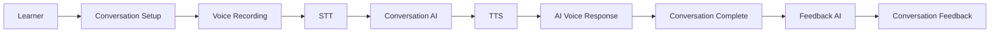
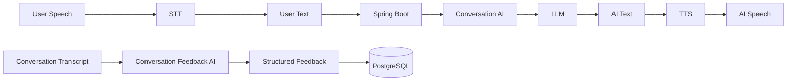
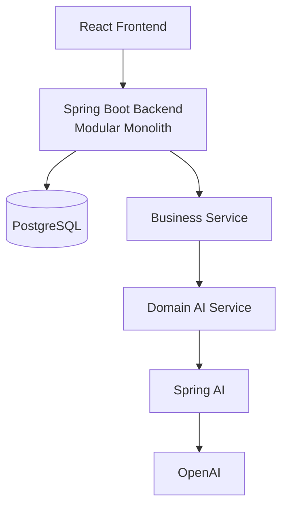

# AI Japanese Speaking

AI와 실제 일본어 음성 대화를 나누고, 학습이 끝난 뒤 표현 중심의 피드백을 받는 Speaking 학습 서비스입니다.

## 프로젝트 소개

이 서비스는 텍스트 문제 풀이보다 실제 발화 경험에 초점을 둡니다. 학습자는 상황과 난이도를 설정한 뒤 음성으로 일본어를 말하고, AI와 대화를 이어가며 학습을 마친 후 대화 전체를 바탕으로 한 피드백을 받습니다.

`상황 설정 → 음성 발화 → AI 일본어 대화 → 학습 종료 → AI Feedback`

### 일반 회화

일상적인 상황에서 AI Persona와 일본어로 대화하며 자연스러운 표현을 연습하는 모드입니다. 상황, 대화 상대의 역할·성격, 난이도, 자막 설정을 바탕으로 대화를 구성하며, 학습 종료 후 자연스러움·문법·어휘·상황 적합성 및 더 자연스러운 대체 표현을 피드백으로 제공합니다. 일반 회화 피드백은 숫자 점수 없이 텍스트 중심으로 제공됩니다.

### 면접 회화

일본어 면접 상황을 연습하는 모드입니다. 면접 설정을 바탕으로 AI 면접관이 질문하고, 학습자의 음성 답변을 일본어 표현뿐 아니라 답변 구조, 논리, 질문 적합성, 구체성, 전달력, Business Japanese 관점에서 평가합니다. 답변 맥락에 따라 Follow-up Question을 생성하며, 면접 종료 후 종합 Interview Feedback을 제공합니다.

## 주요 기능

### 일반 회화

- 상황과 AI Persona 기반의 일본어 대화
- 초급·중급·고급 난이도 및 자막 설정
- 음성 녹음과 STT 기반 사용자 발화 인식
- AI 선발화(Opening)로 대화 시작
- AI 일본어 응답과 TTS 기반 음성 출력
- 녹음 취소 및 학습 중단(Abort) 지원
- 학습 종료 후 Conversation Feedback 생성
- 자연스러움·문법·어휘 피드백과 자연스러운 대체 표현 제안

### 면접 회화

- 면접 설정 기반 AI 면접 질문 생성과 사용자 음성 답변
- 답변별 일본어 표현·내용 평가와 코칭(개선 팁, 모범 답변)
- 답변 맥락 기반 Follow-up Question (기본 질문 최대 5개, 전체 최대 10개)
- 면접 종료 후 최종 Interview Feedback

### 학습 기록

- Learner 본인의 일반 회화·면접 학습 기록 목록 및 상세 조회
- 세션별 Transcript와 저장된 Feedback 다시 보기

### 관리 기능

- **Manager**: 소속 기관 학습자 승인·거절·활성화·비활성화, 기관 이용 현황 Dashboard
- **Admin**: 기관 관리, Manager 승인·상태 관리, 서비스 전체 이용 현황 Dashboard

## 사용자 역할

### Learner

일본어 일반 회화와 면접 학습을 수행하고, 자신의 학습 기록과 피드백을 확인하는 사용자입니다.

### Manager

같은 기관에 소속된 학습자의 승인·상태를 관리하고 기관 이용 현황을 확인하는 역할입니다.

### Admin

플랫폼 운영자로서 기관, Manager 승인·상태, 서비스 전체 이용 현황을 관리하는 역할입니다.

## 서비스 Flow

일반 회화의 기본 학습 흐름입니다.



## AI Processing Flow

음성 처리와 대화 생성, 피드백 생성을 분리합니다. 피드백은 학습 완료 후 전체 Transcript를 기준으로 생성됩니다.



## System Architecture

하나의 Spring Boot 애플리케이션 안에서 도메인 경계를 유지하는 Modular Monolith 구조입니다. 별도의 Python AI Server나 MSA 분리 없이, AI 통신은 Spring AI 계층을 통해 Backend 내부에서 관리합니다.



## Tech Stack

| 영역 | 기술 | 역할 |
| --- | --- | --- |
| Frontend | React 19, Vite, React Router | 학습 화면과 사용자 경험 제공 |
| Backend | Java 21, Spring Boot 3.5, Spring MVC | REST API와 비즈니스 로직 처리 |
| Security | Spring Security, JWT (jjwt) | 인증과 역할 기반 접근 제어 |
| Data | Spring Data JPA, PostgreSQL | 도메인 데이터 저장 및 조회 |
| AI | Spring AI 1.0, OpenAI | LLM(`gpt-4o-mini`)·STT(`gpt-4o-mini-transcribe`)·TTS(`gpt-4o-mini-tts`) 연동 |

## Backend Architecture

Backend는 Domain-first 패키지 구조를 기반으로 구성합니다. 각 도메인은 필요한 책임을 함께 두고, 요청은 기본적으로 다음 계층을 거칩니다.

`Controller → Service → Repository → PostgreSQL`

- **Controller**: HTTP Request/Response 처리와 요청 형식 검증
- **Service**: 비즈니스 로직, Transaction, 도메인 권한 검증
- **Repository**: Spring Data JPA 기반 Database 접근

AI 호출은 Controller가 직접 수행하지 않습니다. `Business Service → Domain AI Service → Common AI Client → Spring AI → OpenAI` 경계를 두어 Conversation과 Interview의 AI 책임을 분리합니다.

## Project Structure

```text
ai-japanese-speaking/
├── frontend/                     # React + Vite
│   └── src/
│       ├── api/                  # 도메인별 API Client (auth, conversations, interviews, history, manager, admin ...)
│       ├── components/           # 공통 UI 컴포넌트
│       │   └── speaking/         # Speaking 공통 헤더, 녹음 Hook(useAudioRecorder) 등
│       └── pages/                # 화면 단위 페이지
├── backend/                      # Spring Boot (Domain-first)
│   └── src/main/java/com/aijapanese/speaking/
│       ├── auth/                 # 로그인·회원가입, JWT, Security 설정
│       ├── user/ organization/   # 사용자·기관
│       ├── speaking/             # 공통 Speaking Session
│       ├── conversation/         # 일반 회화 (+ ai/ 대화·피드백 AI Service)
│       ├── interview/            # 면접 회화 (+ ai/ 질문·평가·코칭·최종 피드백 AI Service)
│       ├── history/              # 학습 기록 조회
│       ├── manager/ admin/       # 관리 기능
│       ├── ai/                   # 공통 AI Client
│       └── common/               # 공통 DTO·예외 처리
├── docs/
│   ├── architecture.md
│   ├── backend-rules.md
│   ├── ai-design.md
│   ├── ai-japanese-speaking-erd-api-spec.md
│   └── ai-japanese-speaking-openapi.yml
├── AGENTS.md
└── README.md
```

## Database

ERD를 기준으로 일반 회화와 면접의 공통 학습 단위를 `Speaking Session`으로 관리하고, 모드별 설정·발화·피드백을 분리합니다.

- **Organization / User**: 기관, 사용자 계정, 역할과 승인 상태 관리
- **Speaking Session**: 일반 회화와 면접 학습의 공통 소유자·유형·진행 상태·이용 시간 관리
- **Conversation**: 일반 회화 설정, 사용자·AI 발화 Transcript, 표현 중심 Feedback 및 교정 관리
- **Interview**: 면접 설정, 질문·답변, 답변별 평가, 전체 Feedback 관리
- **Feedback**: 일반 회화는 무점수 표현 피드백을, 면접은 평가 기준에 따른 답변·종합 피드백을 저장

History는 별도 테이블을 만들지 않고 기존 세션, 설정, 발화, 피드백 데이터를 조회·조합해 제공합니다.

## API

API는 OpenAPI-first 원칙으로 관리합니다. 구현된 주요 API 영역은 다음과 같습니다.

| 영역 | Base Path |
| --- | --- |
| Auth | `/api/auth` (signup, login, me, signup-options) |
| Organization | `/api/organizations` |
| Conversation | `/api/conversations` (opening, turns, complete, abort, feedback) |
| Interview | `/api/interviews` (answer, complete, abort, feedback) |
| History | `/api/history` |
| Manager | `/api/manager/dashboard`, `/api/manager/learners` |
| Admin | `/api/admin/dashboard`, `/api/admin/organizations`, `/api/admin/managers` |

상세 endpoint, 요청·응답 schema, 상태 값은 [OpenAPI 명세](docs/ai-japanese-speaking-openapi.yml)를 참고하세요.

## Security

- Spring Security와 JWT 기반 인증을 사용합니다.
- 비밀번호는 `PasswordEncoder`로 해시하여 저장합니다.
- 현재 사용자는 JWT와 SecurityContext를 기준으로 식별하며, 클라이언트가 전달한 `userId`를 인증 근거로 사용하지 않습니다.
- OpenAI API Key는 Backend에서만 사용하고, Frontend에 전달하지 않습니다.
- JWT Secret, API Key, Database Password 등 Secret은 소스 코드에 하드코딩하지 않고 환경 설정 또는 환경변수로 주입합니다.

## AI 설계 원칙

### Conversation AI와 Feedback AI 책임 분리

Conversation AI는 사용자의 발화에 자연스럽게 일본어로 응답해 대화를 이어갑니다. Feedback AI는 학습 완료 후 전체 Transcript를 평가해 학습 결과를 생성합니다.

### Turn마다 평가하지 않음

일반 회화 중에는 매 Turn마다 문법이나 자연스러움 평가를 생성하지 않습니다. 정상 종료 시 전체 대화를 기준으로 최대 한 번의 Feedback 생성만 수행하며, 이후 Feedback 조회는 저장된 데이터를 사용합니다.

### Structured Feedback

일반 회화 Feedback은 요약, 자연스러움·문법·어휘 코멘트, 강점, 다음 학습 팁, 교정 표현처럼 구조화된 결과로 저장·활용할 수 있도록 설계합니다.

### Speech 역할 분리

- **STT**: Speech → Text
- **LLM**: Text → AI Response
- **TTS**: AI Response → Speech

AI Provider API Key는 Backend에서만 관리하며 브라우저에 노출하지 않습니다.

## Getting Started

### Prerequisites

- Java 21
- Node.js (npm)
- PostgreSQL
- OpenAI API Key

### Environment Variables

Backend는 `application.yml`에서 아래 환경변수를 읽습니다. 실제 값은 저장소에 커밋하지 않습니다.

| 변수 | 설명 |
| --- | --- |
| `DB_URL` | PostgreSQL JDBC URL (예: `jdbc:postgresql://localhost:5432/<db-name>`) |
| `DB_USERNAME` | Database 사용자 |
| `DB_PASSWORD` | Database 비밀번호 |
| `OPENAI_API_KEY` | OpenAI API Key (Backend 전용) |
| `JWT_SECRET` | JWT 서명용 Secret |
| `JWT_EXPIRATION_SECONDS` | Access Token 만료 시간(초), 기본값 `3600` |

### Backend

```bash
cd backend
export DB_URL=jdbc:postgresql://localhost:5432/<db-name>
export DB_USERNAME=<db-username>
export DB_PASSWORD=<db-password>
export OPENAI_API_KEY=<your-openai-api-key>
export JWT_SECRET=<your-jwt-secret>
./gradlew bootRun
```

`http://localhost:8080`에서 실행됩니다. 테이블은 JPA `ddl-auto: update`로 생성·갱신됩니다.

### Frontend

```bash
cd frontend
npm install
npm run dev
```

`http://localhost:5173`에서 실행되며, API는 `http://localhost:8080`으로 요청합니다. Backend CORS는 로컬 개발용으로 `localhost:5173`만 허용합니다.

## Documents

| 문서 | 역할 |
| --- | --- |
| [architecture.md](docs/architecture.md) | 전체 시스템 구조와 Backend·AI Architecture 결정 |
| [backend-rules.md](docs/backend-rules.md) | Spring Boot 구현 규칙 |
| [ai-design.md](docs/ai-design.md) | AI, STT/TTS, Feedback 설계 원칙 |
| [ai-japanese-speaking-erd-api-spec.md](docs/ai-japanese-speaking-erd-api-spec.md) | Database ERD와 API 설계 기준 |
| [ai-japanese-speaking-openapi.yml](docs/ai-japanese-speaking-openapi.yml) | API Contract |

## Current Status

MVP 구현이 완료되었습니다.

- 일반 회화: 설정 → AI 선발화 → 음성 대화(STT/LLM/TTS) → 종료 → Feedback E2E 흐름 완료
- 면접 회화: 질문 생성 → 음성 답변 → 답변 평가·코칭·Follow-up → 최종 Feedback E2E 흐름 완료
- 학습 기록, Manager/Admin Dashboard 및 기관·사용자 관리 완료
- JWT 인증과 계정 상태(승인·활성) 검증 완료
- 리팩토링: Speaking 음성 녹음 로직 Custom Hook(`useAudioRecorder`) 공통화, Speaking 페이지 공통 헤더 컴포넌트 분리

## Future Improvements

- Interview AI 고도화와 Follow-up 정책 개선
- Adaptive Difficulty 및 개인별 약점 기반 Personalized Feedback
- Conversation Context 요약·관리 개선
- Streaming STT, Streaming TTS, 실시간 Conversation
- AI Usage Monitoring과 Token/Cost Monitoring
- Async AI Processing, Queue, Retry / Recovery
