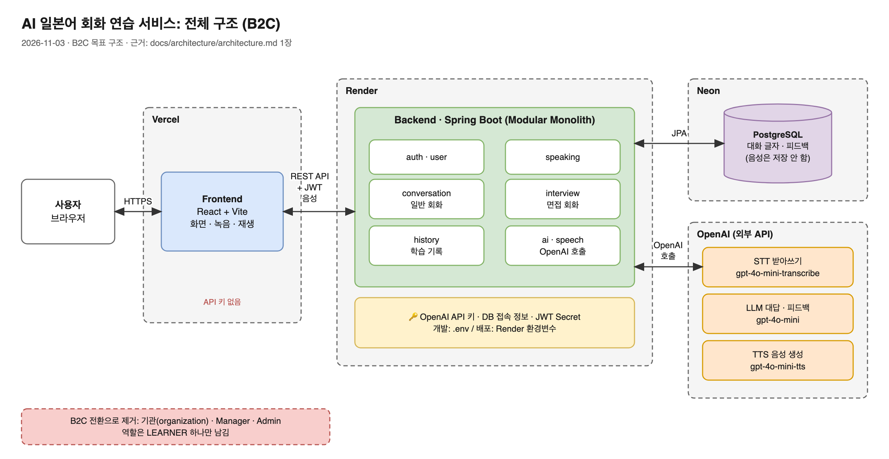
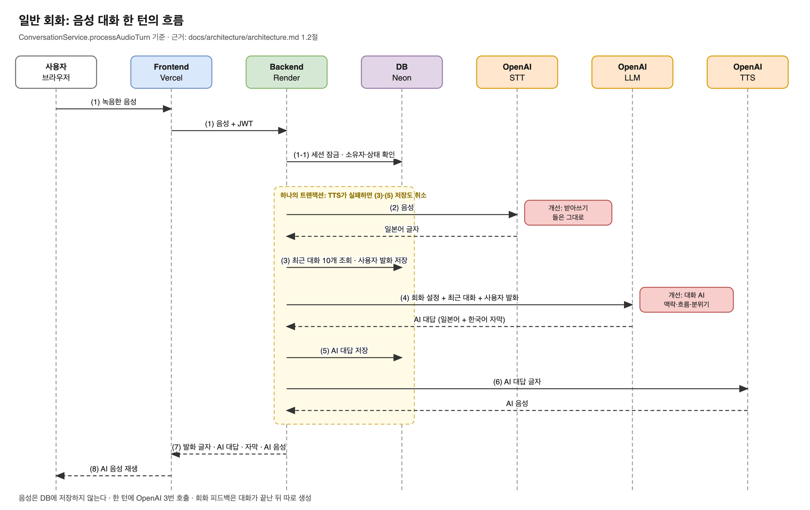

# AI 일본어 Speaking 서비스: Backend Architecture

기준일: 2026-09-09 · B2C 전환 반영: 2026-11-03 (이전 B2B2C 버전은 태그 `v1.0-b2b2c`)

이 문서는 백엔드 구현을 시작하기 전에 확정한 아키텍처 결정을 기록한다. 두 가지 목적을 동시에 가진다.

1. Claude/Codex 등 Coding Agent가 백엔드를 구현할 때 참고하는 context 문서
2. 개발자가 나중에 다시 읽고 "왜 이렇게 설계했는지"를 복습하는 설계 문서

이 문서는 새로운 기능 요구사항이나 API/DB 계약을 정의하지 않는다. 기능·데이터·API 계약의 기준은 아래 문서다.

- ERD/API 기준: [`erd-api-spec.md`](../contracts/erd-api-spec.md)
- OpenAPI 명세: [`openapi.yml`](../contracts/openapi.yml)
- 설계 의도 해설: [`design-study-notes.md`](../notes/design-study-notes.md)
- 기획: [`PRD.md`](../product/PRD.md), 결정 기록: [`decisions.md`](../decisions.md)

이 문서와 위 문서가 충돌하면 위 문서(ERD/API/OpenAPI)가 우선한다. Coding Agent는 충돌을 발견하면 임의로 한쪽을 수정하지 않고 보고한다. 세부 절차는 [`AGENTS.md`](../../AGENTS.md)와 [`backend-rules.md`](../rules/backend-rules.md)를 따른다.

> **B2C 전환 중 상태 (2026-11-03)**: 이 문서는 B2C로 바뀔 **목표 구조**를 적는다. 계약 문서(ERD·OpenAPI)와 코드는 아직 B2B2C 상태(가입 시 기관 선택과 승인, 역할 3개)이며, 계정 명세 단계에서 B2C로 개정한다. 개정 전까지 이 문서의 B2C 내용(1장, 9장, 10장)과 계약 문서는 충돌한다.

## 1. 프로젝트 개요

AI 기반 일본어 Speaking 학습 서비스다.

주요 기능:
- 일반 일본어 회화
- 일본 취업 면접 Speaking
- AI 음성 대화
- 일반 회화 피드백
- 면접 답변 평가 및 꼬리질문
- 학습 History

개인 사용자가 바로 가입해 쓰는 B2C 서비스로 바꾼다. 기관·Manager·Admin 기능을 없앤다(decisions.md 2026-11-02 "B2C 기획 범위"). 현재 코드에는 아직 기관 선택·가입 승인(`AuthService`), 역할 3개(`UserRole`), Manager·Admin 화면이 남아 있다.

전체 흐름:



그림 원본: [`images/architecture-overview.drawio`](images/architecture-overview.drawio) (draw.io에서 열어 고칠 수 있다). 아래는 터미널에서 볼 때를 위한 같은 내용의 글자 그림이다.

```text
[사용자 브라우저]
      │  화면 요청, 로그인, 음성 녹음
      ▼
[Frontend: React + Vite]                 배포: Vercel
      │  REST API + JWT
      ▼
[Backend: Spring Boot]                   배포: Render   (OpenAI API 키는 여기에만)
      │  회원, 일반 회화, 면접 회화, 학습 기록
      │                         │
      │ 저장/조회                │ STT / LLM / TTS
      ▼                         ▼
[DB: PostgreSQL]  배포: Neon   [OpenAI]
```

## 1.1 배포 구성

**결정**: Frontend는 Vercel, Backend는 Render, DB는 Neon에 무료 범위로 배포한다(decisions.md 2026-11-02 "B2C 기획 범위").

| 영역 | 배포처 | 비밀값 |
|---|---|---|
| Frontend (React) | Vercel | 없음. OpenAI API 키를 두지 않는다. Vite의 `VITE_` 환경변수는 빌드 결과에 포함되어 브라우저에서 보인다 |
| Backend (Spring Boot) | Render (Docker 이미지. Render에 Java 기본 실행 환경이 없다) | OpenAI API 키, DB 접속 정보, JWT Secret. 개발 중에는 `.env`(decisions.md 2026-11-02 결정. Spring Boot가 `.env`를 읽는 방법은 개발 계획에서 정하며, 현재는 셸 환경변수를 읽는다), 배포 후에는 Render 환경변수 |
| DB (PostgreSQL) | Neon | — |

**주의**: 무료 Backend는 15분 동안 접속이 없으면 잠들어, Spring Boot가 다시 깨어날 때 30초 이상 걸릴 수 있다. 메모리는 약 512MB라 실제 배포에서 확인한다. 무료 조건은 바뀔 수 있으므로 배포 전에 각 서비스의 요금 페이지를 확인한다.

## 1.2 음성 대화 한 턴의 흐름

일반 회화에서 사용자가 한 번 말할 때의 흐름이다(`ConversationService.processAudioTurn`).



그림 원본: [`images/voice-turn-sequence.drawio`](images/voice-turn-sequence.drawio)

```text
[브라우저]  (1) 녹음한 음성
    ▼
[Frontend]
    ▼
[Backend] ──(1-1) 세션 잠금, 소유자·유형·진행 상태 확인 ──▶ [DB]
    ├─(2) 음성 ───────────────────────────────▶ [OpenAI STT]
    ◀──────────────────────────── 일본어 글자 ──┘
    ├─(3) 최근 대화 10개 조회, 사용자 발화(글자) 저장 ──▶ [DB]
    ├─(4) 회화 설정 + 최근 대화 + 사용자 발화 ──▶ [OpenAI LLM]
    │   ◀──────────────── AI 대답(일본어 + 한국어 자막) ─┘
    ├─(5) AI 대답(글자) 저장 ──────────────────────▶ [DB]
    ├─(6) AI 대답 글자 ───────────────────────────▶ [OpenAI TTS]
    │   ◀──────────────────────────────── AI 음성 ─┘
    ▼
[Frontend] (7) 사용자 발화 글자, AI 대답, 자막, AI 음성
    ▼
[브라우저] (8) AI 음성 재생
```

- STT를 부르기 전에 세션을 잠그고 현재 사용자의 진행 중인 일반 회화 세션인지 확인한다(`loadOwnedInProgressSession`). 확인에 실패하면 OpenAI를 부르지 않는다.
- 음성은 DB에 저장하지 않는다. 사용자 발화와 AI 대답의 글자만 저장한다.
- 한 턴(`processAudioTurn`) 전체가 하나의 트랜잭션이다. (6) TTS가 실패하면 (3)·(5)의 저장도 취소된다.
- 한 턴에 OpenAI를 세 번 호출한다(STT, LLM, TTS). 응답 대기 시간에는 이 세 호출 외에도 DB 처리, 응답 전송, 브라우저의 음성 재생 준비가 포함된다.
- LLM은 최근 대화 10개를 함께 받아 맥락을 유지한다.
- 회화 피드백은 대화가 끝난 뒤 DB에 쌓인 발화 글자로 따로 생성한다.
- PRD 8장의 개선 범위와 연결: 받아쓰기 개선은 (2), 대화 상대 AI 개선은 (4), 회화 피드백 개선은 대화 종료 후 피드백 생성 단계다.

## 2. Backend Architecture: Modular Monolith

**결정**: Modular Monolith로 구성한다. 하나의 Spring Boot 애플리케이션이며, 별도의 MSA 서비스 분리는 하지 않는다.

**왜**: 현재 프로젝트 규모에서는 MSA의 독립 배포, 서비스 간 통신, 분산 데이터 관리 등의 복잡성이 필요하지 않다. 하나의 애플리케이션으로 개발·배포·운영하는 편이 현재 팀 규모와 일정에 맞다.

**단**: 향후 MSA 전환 학습 및 서비스 확장을 고려해 도메인별 책임과 패키지 경계를 명확하게 유지한다. 구체적인 도메인 간 의존성 규칙은 구현 구조를 설계하면서 별도로 정의한다.

## 3. Package Structure: Domain-first

**결정**: Domain-first 패키지 구조를 사용한다. Controller/Service/Repository를 프로젝트 최상위에서 나누는 Layer-first 구조를 사용하지 않는다.

**왜**: Layer-first 구조는 프로젝트가 커질수록 하나의 기능을 이해하기 위해 여러 최상위 패키지를 오가야 한다. Domain-first 구조는 도메인 하나의 책임이 한 패키지 안에 모여 있어 향후 특정 도메인을 별도 서비스로 분리하기도 쉽다.

예상 구조:

```text
backend/
└── src/main/java/.../
    ├── auth/
    ├── user/
    ├── speaking/
    ├── conversation/
    ├── interview/
    ├── history/
    ├── ai/
    └── speech/
```

도메인 내부에서는 필요한 경우에만 계층을 분리한다. 예:

```text
interview/
├── controller/
├── service/
├── repository/
├── entity/
└── dto/
```

모든 도메인이 위 하위 패키지를 전부 가져야 하는 것은 아니다. 실제 책임에 필요한 구조만 사용한다. 예를 들어 `history/`는 4장에서 설명하듯 자체 Entity/Repository가 없으므로 `controller/`, `service/`, `dto/`만 있을 수 있다.

## 4. Layer Architecture

기본 요청 흐름:

```text
Controller
    ↓
Service
    ↓
Repository
    ↓
Database
```

- **Controller**: HTTP Request/Response 처리, Request validation, Service 호출
- **Service**: Business Logic, Transaction, 권한 및 도메인 규칙 검증
- **Repository**: Database 접근

**결정**: Controller가 Repository를 직접 호출하지 않는다. 모든 Repository 접근은 Service를 거친다.

**왜**: Business Logic과 권한 검증이 Service 한 곳에 모여야 일관성을 지킬 수 있다. Controller가 Repository를 직접 호출하면 검증 로직이 여러 곳으로 흩어지기 쉽다.

## 5. DTO: Entity를 API 경계에 노출하지 않는다

**결정**: API Request/Response에는 Request/Response DTO를 사용한다. Entity를 API Request/Response 객체로 직접 사용하지 않는다.

**왜**: Entity를 그대로 노출하면 JPA 연관관계의 지연 로딩, 순환 참조, DB 컬럼 변경이 API 계약에 그대로 새어 나간다. DTO를 두면 API 계약과 DB 스키마를 독립적으로 바꿀 수 있고, OpenAPI 명세와 Java 코드를 1:1로 대응시키기도 쉽다.

흐름:

```text
[요청]  React JSON → Request DTO → Controller → Service → Entity → Repository
[응답]  Entity → Response DTO → Controller → JSON → React
```

**DTO 구조의 기준은 기존 OpenAPI 명세다.** [`openapi.yml`](../contracts/openapi.yml)에 정의된 Request/Response schema와 실제 Java DTO가 일치하도록 구현한다. OpenAPI에 없는 필드를 DTO에 임의로 추가하지 않는다.

## 6. Data Architecture

- **Database**: PostgreSQL
- **ORM / Data Access**: Spring Data JPA

```text
Java Entity
    ↕
Spring Data JPA / JPA
    ↕
PostgreSQL Table
```

**결정**: 기존 ERD를 Database Contract의 기준으로 사용한다. ERD에 없는 Entity/Table/Column을 구현 단계에서 임의로 추가하지 않는다.

**왜**: ERD([`erd-api-spec.md`](../contracts/erd-api-spec.md) 2장, [`erd.dbml`](../contracts/erd.dbml))는 여러 차례 논의를 거쳐 테이블·관계·제약으로 확정한 계약이다. Coding Agent가 편의상 컬럼이나 테이블을 추가하면 ERD와 실제 스키마가 어긋나고, 이후 어느 쪽이 진실인지 알 수 없게 된다.

초기 개발에서는 JPA/Hibernate의 schema 생성 기능(`ddl-auto` 등)을 활용할 수 있지만, 최종적으로는 ERD ↔ Entity ↔ 실제 PostgreSQL schema가 일치하는지 검증한다.

## 7. Domain Relationships

`speaking_sessions`가 Speaking 기능의 공통 중심이다.

```text
User
  ↓
SpeakingSession
   /          \
Conversation  Interview
```

- **Conversation** 관련: SpeakingSession, ConversationSettings, SpeakingMessages, ConversationFeedback, ConversationCorrections
- **Interview** 관련: SpeakingSession, InterviewSettings, SpeakingMessages, InterviewQuestions, InterviewAnswers, InterviewAnswerFeedbacks, InterviewEvaluationScores, InterviewFeedbacks

**결정**: Conversation과 Interview는 공통 SpeakingSession을 사용하지만, 도메인 로직과 API는 분리한다.

**왜**: 두 모드는 같은 "학습 세션"이라는 개념을 공유하지만 진행 방식(자유 대화 vs 질문-답변-평가), 피드백 구조(무점수 요약/교정 vs 점수 기반 rubric 평가), AI 처리 흐름이 근본적으로 다르다. 공통 부분만 `speaking_sessions`로 묶고 나머지는 각 도메인이 독립적으로 소유하는 편이 향후 한쪽만 변경할 때 다른 쪽에 영향을 주지 않는다.

세부 컬럼·관계·상태 값은 [`erd-api-spec.md`](../contracts/erd-api-spec.md) 2장, 3장을 따른다.

## 8. History: 전용 Entity/Table을 만들지 않는다

**결정**: History 전용 Entity/Table은 만들지 않는다. History는 다음 기존 데이터를 조회하고 조합해서 제공하는 **read-oriented 기능**이다.

- SpeakingSession
- ConversationSettings / InterviewSettings
- ConversationFeedback / InterviewFeedback
- SpeakingMessages

**왜**: History가 보여주는 정보(세션 목록, 상세, 피드백)는 전부 위 테이블에 이미 존재한다. 별도 History 테이블을 만들면 원본 데이터와 중복되는 사본을 유지해야 하고, 두 데이터가 어긋나는 문제가 생긴다.

> **Coding Agent 주의**: `history/` 패키지에는 자체 Entity/Repository를 만들지 않는다. `history/service`는 다른 도메인의 Repository(또는 조회용 Query)를 조합해 응답 DTO를 구성하는 역할만 한다.

## 9. 사용자 역할

**결정**: 사용자 역할(`users.role`) 칸은 남기고 값은 `LEARNER` 하나만 쓴다. B2B2C 버전의 `MANAGER`, `ADMIN`과 기관(Organization)은 없앤다(decisions.md 2026-11-03 "B2C 명세: 사용자 역할").

```text
User.role: LEARNER
```

**왜**: 이번 범위가 기존 기능 수정부터라 바꿀 곳이 적은 쪽을 골랐다. 나중에 운영자 기능이 생기면 값만 추가하면 된다.

## 10. Authentication / Authorization

**Spring Security + JWT**를 사용한다.

로그인:

```text
React → POST /api/auth/login → Spring Security → JWT 발급
```

이후 요청: `Authorization: Bearer <JWT>`

**결정**: 사용자 식별을 위해 프론트가 `userId`를 신뢰 기반으로 전달하지 않는다. 인증된 사용자의 ID/Role은 JWT/Security Context를 기준으로 사용한다.

**왜**: 클라이언트가 보낸 `userId`를 그대로 신뢰하면 다른 사용자의 세션·데이터에 접근하는 권한 우회가 가능해진다. ([`erd-api-spec.md`](../contracts/erd-api-spec.md) 1장에도 명시된 정책이다.)

Role: `LEARNER`

**결정**: 인증(로그인했는가)과 소유권 확인(이 데이터가 로그인한 사용자의 것인가)을 구분한다.

| 구분 | 질문 예시 | 책임 위치 |
|---|---|---|
| 인증 | "유효한 JWT로 로그인한 사용자인가?" | Spring Security |
| 소유권 확인 | "이 Speaking 세션이 현재 사용자의 것인가?" | Service (예: `loadOwnedInProgressSession`) |

**왜**: 로그인 여부만으로는 다른 사용자의 세션에 접근하는 것을 막을 수 없다. 세션·기록이 현재 사용자의 것인지는 Service의 도메인 로직에서 확인한다.

## 11. API Contract: OpenAPI-first

**결정**: 기존 OpenAPI YAML([`openapi.yml`](../contracts/openapi.yml))을 API Contract의 기준으로 사용한다. API endpoint, Request/Response 구조, enum 등을 구현 과정에서 임의로 변경하지 않는다.

**왜**: 프론트엔드가 이미 이 계약을 기준으로 화면을 구현했다([`erd-api-spec.md`](../contracts/erd-api-spec.md) 9장 "프론트-ERD 대조" 참고). 백엔드가 임의로 계약을 바꾸면 프론트와 어긋난다.

OpenAPI와 구현 요구가 충돌하면 Coding Agent는 임의로 수정하지 않고 보고한다. 절차는 [`AGENTS.md`](../../AGENTS.md) 6장과 [`backend-rules.md`](../rules/backend-rules.md) 10장을 따른다.

## 12. AI Architecture

**결정**: 별도의 Python AI Server를 만들지 않는다. Spring Boot 내부에서 **Spring AI**를 사용한다.

**왜**: 서비스 하나를 늘리면 배포·모니터링·통신 비용이 늘어난다. 현재 규모에서는 Spring Boot 프로세스 안에서 Spring AI로 LLM을 호출하는 것으로 충분하다.

구조:

```text
ConversationService
    ↓
ConversationAiService
    ↓
Common AI Client
    ↓
Spring AI
    ↓
External LLM

InterviewService
    ↓
InterviewAiService
    ↓
Common AI Client
    ↓
Spring AI
    ↓
External LLM
```

**결정**: Business Service에서 외부 LLM API를 직접 호출하지 않는다. 외부 AI API 통신은 공통 AI Client 계층으로 격리한다.

**왜**: 외부 LLM Provider와의 통신 세부사항이 Business Service에 흩어지지 않도록 공통 AI Client로 격리한다. 이를 통해 Provider 변경이나 공통 통신 정책 변경 시 Business Logic에 미치는 영향을 줄인다.

**결정**: Conversation과 Interview의 AI 로직은 서로 다른 책임을 가지므로 각 Domain AI Service(`ConversationAiService`, `InterviewAiService`)에서 관리한다.

**왜**: 일반 회화는 자유 대화 생성과 무점수 피드백을, 면접은 질문 생성·답변 평가·꼬리질문 결정이라는 서로 다른 프롬프트/파싱 로직을 가진다. 하나의 AI Service에 두 로직을 합치면 도메인 규칙이 뒤섞인다.

> Interview의 세부 Agent 구조(Question Generator / Analyzer / Evaluator / Reflection / Coach / Follow-up, [`design-study-notes.md`](../notes/design-study-notes.md) 12장 참고)는 추후 별도 `ai-design.md`에서 상세 설계할 예정이다. 이 문서에서는 `InterviewAiService`가 이 흐름을 담당한다는 경계만 정하고, 내부 구현 세부사항은 확정하지 않는다.

## 13. AI Processing: 동기 처리 우선

**결정**: MVP에서는 AI 호출을 동기 방식으로 구현한다. Queue/Worker 등의 비동기 인프라는 현재 MVP에 도입하지 않는다.

**왜**: 초기 사용자 규모에서 동기 호출로 충분하고, 비동기 인프라(메시지 큐, 워커, 재시도 정책)를 미리 도입하면 MVP 개발 복잡도만 늘어난다.

ERD의 `generation_status`(`PENDING` / `PROCESSING` / `COMPLETED` / `FAILED`)는 [`erd-api-spec.md`](../contracts/erd-api-spec.md) 3장에 정의된 대로 `conversation_feedbacks`, `interview_answer_feedbacks`, `interview_feedbacks` 세 테이블에 존재한다. 동기 처리라도 이 상태 컬럼 구조는 그대로 유지해, 향후 비동기 평가·재시도로 확장할 때 API/DB 계약을 다시 바꾸지 않아도 되게 한다.

## 14. Speech Architecture

**결정**: STT / LLM / TTS의 책임을 분리한다.

```text
Speech
  ↓
STT
  ↓
Text
  ↓
Conversation / Interview
  ↓
Domain AI Service
  ↓
LLM
  ↓
Text
  ↓
TTS
  ↓
Speech
```

**왜**: STT/TTS는 음성 ↔ 텍스트 변환이라는 별개의 관심사이고, LLM은 텍스트를 받아 대화/평가를 생성하는 관심사다. 두 관심사를 분리하면 STT/TTS Provider를 바꾸거나 LLM 프롬프트를 바꿀 때 서로 영향을 주지 않는다.

Spring 내부에서 개념적으로 아래 구조를 사용할 수 있다.

```text
speech/
├── stt/
└── tts/
```

현재 구현은 OpenAI를 쓴다: STT `gpt-4o-mini-transcribe`, TTS `gpt-4o-mini-tts`, LLM `gpt-4o-mini`(README "Tech Stack", 코드 기준). B2C 개선에서 STT는 말하다 취소한 말, 작은 목소리, 문법적으로 틀린 말도 고치지 않고 들은 그대로 받아 적어야 한다(PRD 8.3장). 모델·설정 선택은 받아쓰기 개선 명세에서 정한다.

## 15. Architecture Principles

- Modular Monolith
- Domain-first package 구조
- 명확한 도메인 경계 유지
- Controller → Service → Repository
- DTO 기반 API 경계 (Entity를 API에 노출하지 않음)
- OpenAPI-first API contract
- ERD 기반 Database contract
- Spring Data JPA
- PostgreSQL
- Spring Security + JWT, 인증과 소유권 확인 구분 (Role은 `LEARNER` 하나)
- Spring AI, 도메인 AI 로직과 외부 AI Client 분리
- Speech(STT/TTS) 책임과 LLM 책임 분리
- MVP는 단순하게 유지하되 확장 지점은 보존 (동기 처리 + `generation_status` 구조)

## 16. Appendix — 향후 MSA 전환

현재는 서비스 규모와 개발 복잡도를 고려해 Modular Monolith를 선택했다. 각 Domain의 책임과 경계를 명확하게 유지해, 향후 일부 Domain을 독립 서비스로 분리할 수 있도록 설계한다.

**주의**: 아래 항목은 향후 학습·개선 대상으로만 기록한다. 현재 프로젝트에서 MSA를 구현하는 것처럼 다루지 않는다.

향후 검토 대상:
- Service boundary 재정의
- 서비스별 DB ownership
- Inter-service communication
- API Gateway
- 인증 정보 전달 방식
- 독립 배포
- 장애 전파/복구 전략
