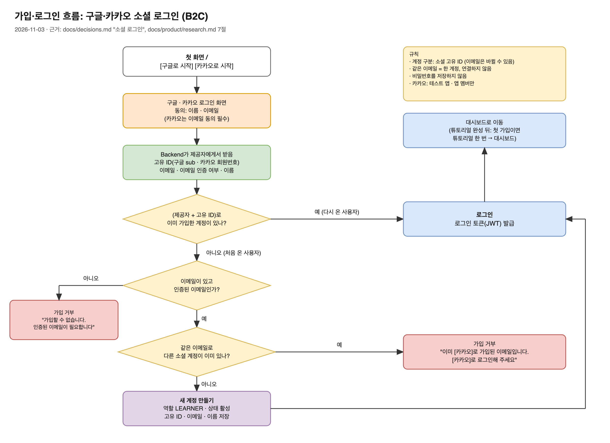

# 계정 명세: 소셜 로그인 (B2C)

작성일: 2026-11-03 · 상태: 초안

근거: [decisions.md](../decisions.md) 2026-11-03 "소셜 로그인", "사용자 역할", [PRD.md](../product/PRD.md) 8.1장, [research.md](../product/research.md) 7절. 유스케이스와 테스트케이스는 기획자와 정한 흐름을 Claude가 정리한 것이다.

## 1. 흐름

그림 원본: [`social-login-flow.drawio`](../architecture/images/social-login-flow.drawio)

규칙
- 가입·로그인은 구글·카카오 소셜 로그인만 쓴다. 비밀번호를 저장하지 않는다.
- 계정은 (제공자, 제공자의 고유 ID)로 구분한다. 구글은 `sub`, 카카오는 회원번호 `id`.
- 이메일은 같은 이메일 가입을 막는 확인용으로만 쓴다. 인증된 이메일만 인정한다.
- 같은 이메일은 한 계정이다. 다른 소셜 계정과 연결하지 않고 가입을 막는다.
- 이메일이 없거나 인증되지 않았으면 가입을 막는다.
- 새 계정은 역할 `LEARNER`, 상태 활성(`ACTIVE`)이다.
- 이름과 이메일은 가입할 때 받은 값으로 고정한다. 제공자 쪽에서 바뀌어도 갱신하지 않는다.
- 제공자 로그인 화면에서 취소하면 첫 화면으로 돌아가 "로그인이 취소되었습니다"만 안내한다.
- 회원 탈퇴는 계정과 학습 기록을 모두 삭제하고, 카카오는 연결도 끊는다. 구글은 연결을 끊지 않고 구글 계정 설정에서 직접 끊을 수 있다고 안내한다(제공자 토큰을 저장하지 않으므로). 연결 끊기가 실패해도 우리 쪽 데이터는 지우고 탈퇴를 끝낸다. 같은 소셜 계정으로 다시 가입하면 새 계정이 된다.
- 카카오는 이메일 동의를 필수로 설정한다. 테스트 앱으로 운영하므로 앱 멤버만 쓸 수 있다.

## 2. 유스케이스

### UC-1 처음 가입하기

| 칸 | 내용 |
|---|---|
| 행위자 | 처음 온 사용자 |
| 목표 | 구글이나 카카오 계정으로 가입해 대시보드에 들어간다 |
| 사전 조건 | 이 소셜 계정(제공자 + 고유 ID)으로 가입한 적이 없다. 소셜 계정에 인증된 이메일이 있다. 같은 이메일로 가입한 다른 소셜 계정이 없다 |
| 정상 흐름 | 첫 화면에서 [구글로 시작] 또는 [카카오로 시작] → 제공자 로그인·동의(이름, 이메일) → 서비스가 고유 ID·이메일·인증 여부·이름을 받음 → 새 계정 생성 → 로그인 토큰 발급 → 대시보드 |
| 사후 조건 | 계정이 하나 생긴다(제공자, 고유 ID, 이메일, 이름, 역할 `LEARNER`, 상태 `ACTIVE`). 비밀번호는 저장하지 않는다. 다음부터는 UC-2로 들어온다 |

### UC-2 다시 로그인하기

| 칸 | 내용 |
|---|---|
| 행위자 | 이미 가입한 사용자 |
| 목표 | 가입한 소셜 계정으로 다시 들어가 대시보드를 쓴다 |
| 사전 조건 | 같은 제공자와 같은 고유 ID로 가입한 계정이 있다 |
| 정상 흐름 | 첫 화면에서 가입한 제공자 버튼 → 제공자 로그인 → 서비스가 (제공자, 고유 ID)로 기존 계정을 찾음 → 로그인 토큰 발급 → 대시보드 |
| 사후 조건 | 새 계정은 생기지 않는다. 마지막 로그인 시각이 갱신된다 |

### UC-3 같은 이메일로 다른 소셜 계정 가입 시도

| 칸 | 내용 |
|---|---|
| 행위자 | 카카오로 이미 가입한 사용자 (반대 경우도 같다) |
| 목표 | 같은 이메일의 구글 계정으로 들어가려 한다 |
| 사전 조건 | 이메일 A로 카카오 계정이 가입되어 있다. 구글 계정의 인증된 이메일도 A다 |
| 정상 흐름 | [구글로 시작] → 구글 로그인 → (구글, 고유 ID)로 찾은 계정 없음 → 이메일 A로 가입한 카카오 계정 있음 → 가입 거부 |
| 사후 조건 | 새 계정이 생기지 않는다. 기존 카카오 계정은 바뀌지 않는다. 화면에 "이미 카카오로 가입된 이메일입니다. 카카오로 로그인해 주세요"가 보인다 |

### UC-4 이메일이 없거나 인증되지 않은 소셜 계정으로 가입 시도

| 칸 | 내용 |
|---|---|
| 행위자 | 처음 온 사용자 |
| 목표 | 이메일이 없거나 인증되지 않은 소셜 계정으로 가입하려 한다 |
| 사전 조건 | 이 소셜 계정으로 가입한 적이 없다. 제공자가 이메일을 주지 않았거나(카카오 계정에 이메일 미등록 등) 인증되지 않은 이메일을 줬다 |
| 정상 흐름 | 소셜 로그인 → 찾은 계정 없음 → 이메일 확인 실패 → 가입 거부 |
| 사후 조건 | 새 계정이 생기지 않는다. 화면에 "가입할 수 없습니다. 인증된 이메일이 필요합니다"가 보인다 |

### UC-5 로그아웃

| 칸 | 내용 |
|---|---|
| 행위자 | 로그인한 사용자 |
| 목표 | 서비스에서 나간다 |
| 사전 조건 | 로그인 상태다 |
| 정상 흐름 | 사이드바 프로필 메뉴의 [로그아웃] → 브라우저에 저장된 로그인 토큰과 사용자 정보 삭제 → 첫 화면 |
| 사후 조건 | 로그인이 필요한 화면에 들어가면 첫 화면으로 돌아간다. 서버 쪽 토큰 폐기는 하지 않는다(backend-rules.md 미확정 사항, 현재 구현과 같음) |

### UC-6 로그인 토큰이 만료되거나 무효일 때

| 칸 | 내용 |
|---|---|
| 행위자 | 로그인했던 사용자 |
| 목표 | 서비스를 계속 쓰려 한다 |
| 사전 조건 | 브라우저의 로그인 토큰이 만료되었거나 무효하다 |
| 정상 흐름 | API 요청 → 서버가 401 응답 → 첫 화면으로 이동 (현재 구현: `AUTH_EXPIRED_EVENT`) |
| 사후 조건 | 다시 소셜 로그인(UC-2)으로 들어온다 |

### UC-7 소셜 로그인 취소

| 칸 | 내용 |
|---|---|
| 행위자 | 처음 왔거나 다시 온 사용자 |
| 목표 | 구글·카카오 로그인 화면에서 마음을 바꿔 나온다 |
| 사전 조건 | 제공자 로그인·동의 화면에 있다 |
| 정상 흐름 | 취소 또는 동의 거부 → 서비스로 돌아옴(제공자가 `access_denied` 등의 오류를 함께 보냄) → 첫 화면에 "로그인이 취소되었습니다" 안내 |
| 사후 조건 | 계정이 생기거나 바뀌지 않는다. 로그인 토큰이 발급되지 않는다 |

### UC-8 회원 탈퇴

| 칸 | 내용 |
|---|---|
| 행위자 | 로그인한 사용자 |
| 목표 | 서비스에서 탈퇴하고 내 데이터를 지운다 |
| 사전 조건 | 로그인 상태다 |
| 정상 흐름 | 설정 화면의 [회원 탈퇴] → 삭제되는 내용을 안내하고 한 번 더 확인(구글 가입자에게는 구글 계정 설정에서 연결을 직접 끊을 수 있다는 안내도 보임) → 확인 → 카카오 가입자면 서비스가 카카오 연결을 끊음(앱 관리자 키 사용) → 계정과 학습 기록 삭제 → 브라우저의 토큰·사용자 정보 삭제 → 첫 화면 |
| 사후 조건 | 계정, Speaking 세션, 대화 메시지, 피드백, 설정이 남지 않는다. 같은 소셜 계정으로 다시 오면 UC-1(처음 가입)로 새 계정이 생긴다. 이전 토큰으로 요청하면 401이다 |

## 3. 테스트케이스

소셜 제공자(구글·카카오) 응답은 테스트에서 가짜(mock)로 만든다. 실제 구글·카카오 연동은 수동 확인 항목으로 따로 둔다.

| ID | 유스케이스 | 주어진 상태 | 행동 | 확인할 결과 |
|---|---|---|---|---|
| TC-1 | UC-1 | 계정 없음. 구글 응답: 고유 ID `g-1`, 이메일 `a@x.com`, 인증됨, 이름 `홍길동` | 구글 로그인 완료 처리 | 계정 1개 생성(제공자 구글, 고유 ID `g-1`, 이메일 `a@x.com`, 이름 `홍길동`, 역할 `LEARNER`, 상태 `ACTIVE`, 비밀번호 없음). 로그인 토큰 발급 |
| TC-2 | UC-1 | 계정 없음. 카카오 응답: 회원번호 `k-1`, 이메일 `b@x.com`, 인증됨 | 카카오 로그인 완료 처리 | 계정 1개 생성(제공자 카카오, 고유 ID `k-1`). 로그인 토큰 발급 |
| TC-3 | UC-2 | (구글, `g-1`) 계정 있음 | 같은 구글 응답으로 로그인 | 계정 수 그대로. 기존 계정으로 토큰 발급. 마지막 로그인 시각 갱신 |
| TC-4 | UC-2 | (구글, `g-1`) 계정 있음, 저장된 이메일 `a@x.com`, 이름 `홍길동` | 구글 응답의 이메일이 `new@x.com`, 이름이 `김길동`으로 바뀌어 옴 | 같은 계정으로 로그인한다(고유 ID로 찾으므로). 저장된 이메일·이름은 `a@x.com`, `홍길동` 그대로다(가입 때 값으로 고정) |
| TC-5 | UC-3 | (카카오, `k-1`) 계정 있음, 이메일 `a@x.com` | 구글 응답: 고유 ID `g-2`, 이메일 `a@x.com`, 인증됨 | 가입 거부, 거부 사유가 "카카오로 가입된 이메일"임을 알려 줌. 계정 수 그대로 |
| TC-6 | UC-3 | (구글, `g-1`) 계정 있음, 이메일 `a@x.com` | 카카오 응답: 회원번호 `k-2`, 이메일 `a@x.com`, 인증됨 | 가입 거부(구글로 가입된 이메일). 계정 수 그대로 |
| TC-7 | UC-4 | 계정 없음 | 구글 응답의 `email_verified`가 거짓 | 가입 거부("인증된 이메일이 필요합니다"). 계정 생성 안 됨 |
| TC-8 | UC-4 | 계정 없음 | 카카오 응답에 이메일 없음 | 가입 거부. 계정 생성 안 됨 |
| TC-9 | UC-4 | 계정 없음 | 카카오 응답의 이메일 인증 여부가 거짓 | 가입 거부. 계정 생성 안 됨 |
| TC-10 | UC-5 | 로그인 상태 | [로그아웃] 클릭 | 브라우저 저장소의 토큰·사용자 정보 삭제, 첫 화면 이동. 이후 `/dashboard` 접근 시 첫 화면으로 이동 |
| TC-11 | UC-6 | 만료된 토큰 보유 | 로그인이 필요한 API 요청 | 401 응답, 첫 화면으로 이동 |
| TC-13 | UC-7 | 계정 없음 | 제공자가 `access_denied`로 돌아옴 | 첫 화면, "로그인이 취소되었습니다" 안내. 계정 생성 안 됨, 토큰 없음 |
| TC-14 | UC-8 | (구글, `g-1`) 계정과 일반 회화 세션·메시지·피드백·설정 있음 | 탈퇴 확인 | 해당 계정과 연결된 세션·메시지·피드백·설정이 모두 삭제됨. 구글 가입자라 제공자 연결 끊기 요청은 호출되지 않음. 다른 사용자의 데이터는 그대로 |
| TC-15 | UC-8 | 탈퇴 완료, 이전 토큰 보유 | 그 토큰으로 API 요청 | 401 |
| TC-16 | UC-8 | (구글, `g-1`)로 가입했다가 탈퇴함 | 같은 구글 응답으로 로그인 | 새 계정이 생긴다(UC-1). 이전 학습 기록은 보이지 않는다 |
| TC-17 | UC-8 | 탈퇴 확인 화면 | [취소] | 아무것도 삭제되지 않는다 |
| TC-19 | UC-8 | (카카오, `k-1`) 계정 있음 | 탈퇴 확인 | 카카오 연결 끊기 요청이 회원번호 `k-1`로 호출되고, 계정이 삭제됨 |
| TC-18 | UC-8 | (카카오, `k-1`) 계정 있음 | 탈퇴 확인, 카카오 연결 끊기 요청이 실패 | 우리 쪽 계정과 학습 기록은 삭제되고 탈퇴가 끝난다 |
| TC-12 | 규칙 | (구글, `g-1`) 계정 있음 | (카카오, `g-1`) 응답(고유 ID 값이 우연히 같음), 이메일 `c@x.com` | 다른 계정으로 본다(제공자가 다르므로). 새 계정 생성 |

### 수동 확인 (실제 연동)

| ID | 확인할 것 |
|---|---|
| M-1 | 실제 구글 계정으로 가입 → 대시보드 진입 |
| M-2 | 카카오 테스트 앱에 앱 멤버로 등록한 계정으로 가입 → 대시보드 진입 |
| M-3 | 카카오 동의 화면에서 이메일이 필수 항목으로 보이고, 동의하지 않으면 로그인이 끝나지 않는다 |
| M-5 | 실제 카카오 계정으로 탈퇴 후, 카카오 쪽 연결된 서비스 목록에서 이 서비스가 사라진다. 구글 탈퇴 화면에는 직접 연결을 끊는 안내가 보인다 |
| M-4 | 배포 주소(Vercel·Render)에서 로그인 후 돌아오는 주소(redirect URI)가 맞게 동작한다 |

## 4. 열린 질문

없음. 토큰 전달 방식은 decisions.md 2026-11-03 "소셜 로그인 후 토큰 전달 방식"으로 정했다. API 계약은 [openapi.yml](../contracts/openapi.yml)의 `/api/auth/oauth/{provider}`, `DELETE /api/users/me`.
